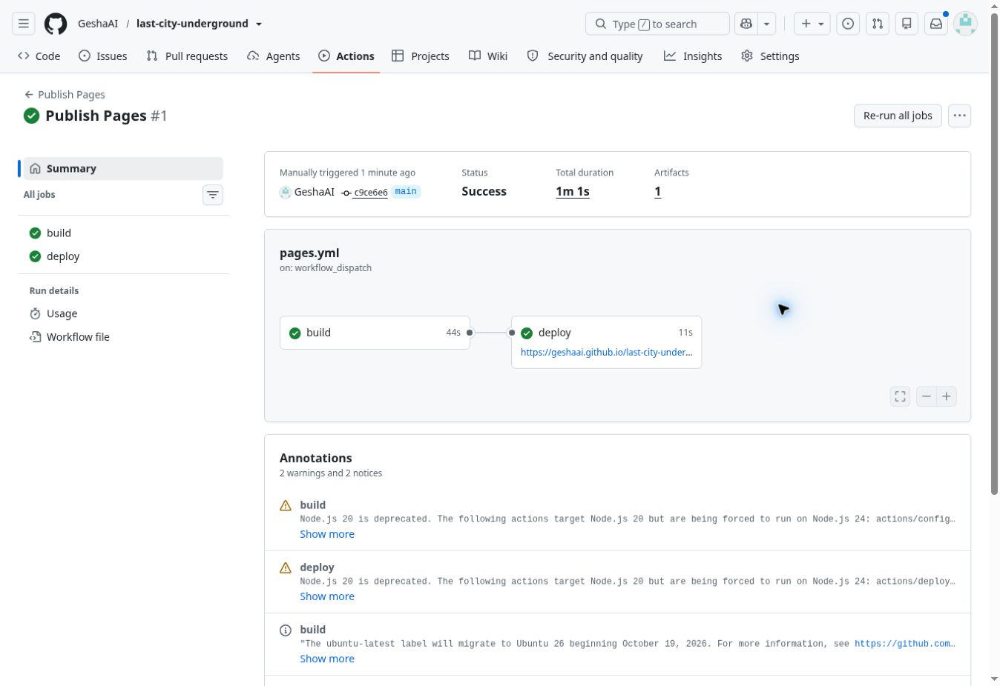

# Отчёт передачи — 2026-10-12

- Локально npm test: 145 passed, 0 failed, 0 skipped; 66.5 s.
- npm run check: синтаксис модулей и standalone, относительные зависимости, файлы ресурсов и воспроизводимость сборки — PASS.
- Все исходные файлы кроме расширенного package.json совпадают с v0.2.20 по SHA-256; BASELINE_SHA256.json включает исходный package.json.
- Базовая версия загружена GitHub connector в 5df174e45323bc4a9d2299dc16c80bd964e51c52; backup/v0.2.20 создана.
- Выполнен поиск типовых секретов в передаваемых файлах; совпадений нет. .git/config, credentials, окружение и игровые сохранения не включены. Это не формальный аудит безопасности.
- Старый Sites не публиковался заново и его код не менялся.
- Физический Android и полный ручной browser smoke-test строительства/тоннелей/IndexedDB пока НЕ выполнены в рамках этой передачи. Node-тесты покрывают модель, не все браузерные взаимодействия.
- Проблемы A/B остаются известными в резервной v0.2.20.

Актуальные результаты GitHub CI и публикации доступны во вкладке Actions; наличие workflow само по себе не означает успешный прогон.

## Проверка удалённого репозитория

GitHub connector подтвердил владельца GeshaAI и доступ push/admin. Выполнен независимый git clone ветки передачи из GitHub; 32 неизменённых исходных файла сверены SHA-256 с оригиналом, все 7 документов присутствуют, npm run check выполнен именно в свежем клоне.

CI PR #1 успешно выполнил npm test и npm run check: https://github.com/GeshaAI/last-city-underground/actions/runs/38308584298 . PR #1 объединён в main commit c9ce6e6aa9b2d1b4b531151431378ce3ab585e5f.

Sites API после переноса по-прежнему возвращает version 24 / source dc62016b0dc519620a83bef3b58f0f860ae7bcc7 / deployment appgdep_6acd124b48a481918c9758ec70020213. Рабочая копия исходного Site чистая. Прямое скачивание файлов старого сайта из shell получило HTTP 403, поэтому это не подтверждение доступности браузера пользователя; production код не изменён.

Защита main: форма PR + обязательный verify + up-to-date + запрет bypass подготовлена, но GitHub запросил повторное подтверждение личности (sudo). Правило НЕ подтверждено как включённое. До завершения владельцем соблюдать PR-процесс; CI сам по себе не запрещает прямой push.

## Независимая публикация

Publish Pages #1 завершился success (build + deploy) на commit c9ce6e6aa9b2d1b4b531151431378ce3ab585e5f: https://github.com/GeshaAI/last-city-underground/actions/runs/38308887045 . Адрес: https://geshaai.github.io/last-city-underground/ . Сборка опубликована из dist через GitHub Actions, исходный Sites не затронут.

Workflow сообщил предупреждения об устаревающем внутреннем Node 20 некоторых официальных actions (runner выполнил их на Node 24) и предстоящем изменении ubuntu-latest. Это предупреждения, не ошибки текущей сборки; при обслуживании CI обновить совместимые версии официальных actions.

Дополнительно: все 9 файлов опубликованного dist скачаны по HTTPS с GitHub Pages, получили HTTP 200 и совпали побайтно с GitHub. Публичная игра открыта в desktop Chrome: показаны v0.2.20, стартовый бункер, ресурсы, мини-карта и управление; на старте ошибок приложения в доступном журнале нет (есть сообщения расширения браузера). Это только проверка запуска, не полный игровой smoke-test и не Android.
